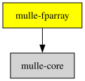

# mulle-fparray

#### 🛸 A typed, growable array of floats

The mulle-floatarray contained in this library is used as a known type in
animation code MulleCA. It's almost identical to mulle-structarray from
[mulle-container](https://github.com/mulle-container), but the element type
(`float`) is fixed and known at compile time.


| Release Version                                       | Release Notes  | AI Documentation
|-------------------------------------------------------|----------------|---------------
|  [](//github.com/mulle-gfx/mulle-fparray/actions) | [RELEASENOTES](RELEASENOTES.md) | [DeepWiki for mulle-fparray](https://deepwiki.com/mulle-gfx/mulle-fparray)


## Documentation & Guides

* [API Summary](asset/dox/api/toc)
* [Coder Guide](asset/howto/coder/mulle-fparray)

## Usage

A typed, growable array of `float`. `_mulle_floatarray_advance` hands you
storage that is already counted as used:

``` c
#include <mulle-fparray/mulle-fparray.h>

int  main( void)
{
   struct mulle_floatarray  array;

   mulle_floatarray_init( &array, 4, NULL);

   float  *slot = _mulle_floatarray_advance( &array, 3);
   slot[ 0] = 1.0f;
   slot[ 1] = 2.0f;
   slot[ 2] = 3.0f;

   float  sum = 0.0f;
   float  value;
   mulle_floatarray_for( &array, value)
      sum += value;

   mulle_floatarray_done( &array);
   return( 0);
}
```


### You are here




## Add

**This project is a component of the [mulle-gfx](//github.com/mulle-gfx/mulle-gfx) library.
As such you usually will *not* add or install it individually, unless you
specifically do not want to link against `mulle-gfx`.**


### Add as an individual component

Use [mulle-sde](//github.com/mulle-sde) to add mulle-fparray to your project:

``` sh
mulle-sde add github:mulle-gfx/mulle-fparray
```

To only add the sources of mulle-fparray with dependency
sources use [clib](https://github.com/clibs/clib):


``` sh
clib install --out src/mulle-gfx mulle-gfx/mulle-fparray
```

Add `-isystem src/mulle-gfx` to your `CFLAGS` and compile all the sources that were downloaded with your project.


## Install

### Install with mulle-sde

Use [mulle-sde](//github.com/mulle-sde) to build and install mulle-fparray and all dependencies:

``` sh
mulle-sde install --prefix /usr/local \
   https://github.com/mulle-gfx/mulle-fparray/archive/latest.tar.gz
```

### Manual Installation

Install the requirements:

| Requirements                                 | Description
|----------------------------------------------|-----------------------
| [mulle-core](https://github.com/mulle-core/mulle-core)             | 🌋 Almagamated library of mulle-core + mulle-concurrent + mulle-c

Install **mulle-fparray** into `/usr/local` with [cmake](https://cmake.org):

``` sh
cmake -B build \
      -DCMAKE_INSTALL_PREFIX=/usr/local \
      -DCMAKE_PREFIX_PATH=/usr/local \
      -DCMAKE_BUILD_TYPE=Release &&
cmake --build build --config Release &&
cmake --install build --config Release
```


## Author

[Nat!](https://mulle-kybernetik.com/weblog) for Mulle kybernetiK  


